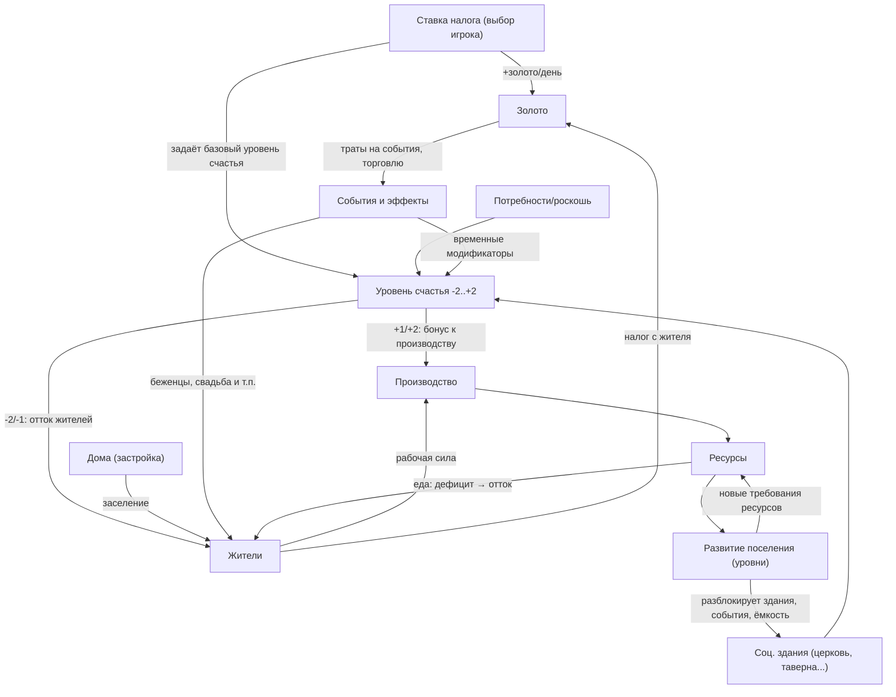

# 🏘️ CBP: спецификация систем (черновик v2)

> **Статус.** Это спецификация **целевой** игры, план этапа 2.
> На 2026 год реализовано **0%** систем, описанных ниже: сейчас игра
> работает по модели старого прототипа (см. `GAME_DOCUMENTATION.md`).
>
> Что уже подготовлено под этот документ:
> * в `js/balance.js` есть разделы `taxes`, `tierTaxMult`, `development`,
>   `happiness.phase2Levels`;
> * события описаны данными, а не кодом, и легко получают новые виды;
> * сид партии сохраняется, поэтому возможны прогоны симуляций.
>
> Порядок и оценка работ — в `docs/ROADMAP.md`, устройство кода — в
> `docs/ARCHITECTURE.md`.

Концепция: **симулятор бога с непрямым управлением** — игрок не строит здания и не выбирает места, он принимает решения (в т.ч. через события) и наблюдает, как город визуально растёт и живёт.

> Все цифры в документе — условные. В игре они задаются переменными в едином **файле баланса** (`js/balance.js`), см. §6.

## 1. Как системы увязаны между собой



**Основные циклы:**

1. **Налоговый маятник** (ядро экономики, а-ля Anno 1404): игрок повышает налог → золото растёт, но счастье падает → производство падает и жители уходят → доход снижается с задержкой. Низкий налог — наоборот. Игрок постоянно ищет оптимум под текущую фазу игры.
2. **Соц. здания — якоря счастья**: позволяют держать высокий налог, не проваливаясь по уровню счастья. Это главный «золотойsink» для экономики.
3. **События — возмущения системы**: проверка запаса прочности (золото, ресурсы, счастье). Соц. здания — демпфер (сокращают длительность/тяжесть эффектов).
4. **Развитие — ресурсный sink и цель**: накопление и **сжигание** разнообразных ресурсов для перехода на уровень открывает новые здания, события, повышает лимит населения — новый виток циклов 1–3.
5. **Население — рабочая сила и налоговая база**: счастье управляет только **оттоком**; приток жителей — исключительно через застройку домов и события (беженцы, свадьба). Население управляет производством и доходом.

## 2. Система счастья

5 уровней: −2, −1, 0, +1, +2. Уровень вычисляется каждый день из **базового уровня от ставки налога** (§3) + модификаторов (соц. здания, потребности, активные эффекты событий), с ограничением в [−2, +2].

| Уровень | Ежедневный эффект | Комментарий |
|---------|--------------------|-------------|
| −2 | поселение покидает `leavePerDayHigh` жителей (сначала свободные, потом рабочие) | депопуляция |
| −1 | покидает `leavePerDayLow` (< leavePerDayHigh) | предупреждение |
| 0 | нейтрально | — |
| +1 | бонус к производству `prodMultPlus1` (напр. +10%) | |
| +2 | бонус к производству `prodMultPlus2` (напр. +25%) | |

**Приток жителей — только через постройки и события.** Счастье регулирует лишь отток (−1/−2) и бонусы к производству (+1/+2). Новые жители появляются: (а) при застройке новых домов, (б) через события (беженцы, свадьба, паломники). Рост населения = решение игрока о застройке, а не пассивный автоприток.

**Доп. штраф производству при −1/−2 не вводим** (решено): производство падает само собой — меньше жителей → меньше рабочих → меньше продукции. Бунт — случайное событие (§5).

## 3. Система налогов

Ставка налога — **постоянная политика игрока**, меняется действием выбора («Изменить налоги»), не занимает слот каждый ход. Вся таблица — из баланса:

| Ставка | Базовый уровень счастья | Золото с жителя в день |
|--------|--------------------------|------------------------|
| 10% | +2 | 1 |
| 20% | +1 | 2 |
| 30% | 0 | 3 |
| 40% | −1 | 4 |
| 50% | −2 | 5 |

**Доход/день = Σ(жители × золото по ставке × `tierTaxMult`) + бонусы соц. зданий (рынок).**

**Налоги растут с тиром** (решено): после перехода на следующий уровень играем с жителями нового тира — они платят больше. Базовая шкала ниже умножается на `tierTaxMult` тира (напр. ×1, ×2, ×4, ×8).

Связка с счастьем: ставка задаёт *базу*, соц. здания и положительные эффекты могут удерживать уровень выше базы (напр., налог 40% + церковь + таверна = фактически −1+2 = 0+). Это и есть основная стратегическая глубина: «сколько соц. зданий мне нужно, чтобы тянуть высокий налог».

## 4. Социальные здания

Не производят ресурсы. Эффекты: к счастью, к производству, к золоту, сокращение длительности/тяжести негативных эффектов событий, охват.

**Правила действия (предложение):**
- Стакаются ли эффекты нескольких копий одного здания — **открытый вопрос, решим по плейтесту**. Рабочий вариант для старта: эффект одного типа не стакается, вторая копия здания нужна для «охвата» выросшего населения (`coveragePerBuilding` жителей) — как в Anno, где потребности покрываются один раз.
- Разблокировка — по уровню поселения (§6).

| Здание | Эффект (все числа — из баланса) | Прототип из Anno |
|--------|----------------------------------|------------------|
| 🛒 Рынок | +`marketGoldPerCitizen` золота с жителя в день | Market (покрытие потребностей) |
| 🛣️ Дороги | +`roadProdBonus`% к производству; −1 день к эффектам «перебоев подвоза» (засуха/буря) | Roads (скорость повозок) |
| ⛪ Часовня → Церковь | +1 шаг к базовому счастью; событие «паломники» | Faith (церковь — базовая потребность в Anno) |
| 🍺 Таверна | +1 шаг к счастью; скидка `festivalDiscount` на событие «Праздник» | Pub / Schnapps-роскошь |
| 🌳 Площадь / Парк | +1 шаг к счастью; +1 день к позитивным эффектам | Ornaments/Gardens (attractiveness) |
| 🕯️ Колодец | −`wellFireDamage`% к ущербу от пожара | — (пожарная инфраструктура) |
| 🚒 Пожарная станция | −2 дня к эффекту пожара | Fire Station |
| 🏥 Больница | −`hospitalPlagueDays` дней к эффекту эпидемии | Hospital |
| 👮 Стража / Сторожевая башня | −ущерб от налётов; предотвращает «Бунт» при −2 | Police (беспорядки в Anno) |
| 🏫 Школа | +`schoolProdBonus`% к производству; открывает событие «Изобретатель» | School (потребность, потом исслед.) |
| 🎭 Театр | +1 шаг к счастью; усиливает «Праздник» (+1 к эффекту) | Variety Theatre |
| 🏦 Банк | +`bankGoldPct`% к доходу с налогов | — (производный от торговли/аттрактивности) |
| 🏛️ Ратуша | −1 день ко **всем** негативным эффектам | Town Hall (радиусы/эффекты) |
| ⚓ Пристань / Маяк | торговцы предлагают +`tradeOfferBonus` товаров и лучшие цены | Harbour / Trade Union |
| 🗿 Памятник | +1 шаг к счастью, дорого, статусный (город+) | Monuments/Ornaments |
| 🌐 Акведук / Водопровод | +`aqueductProdBonus`% к производству (город+) | Electricity (модификатор производства) |

## 5. События и эффекты

С наступлением дня может выпасть событие — в этот ход игроку показываются **только выборы этого события**. Результаты оформляются как **временные эффекты** с длительностью в днях (модификаторы счастья/производства/дохода), которые соц. здания сокращают.

**Механика эффектов (предложение):** активные эффекты хранятся списком `{type, magnitude, daysLeft}` и тика каждый день; несколько эффектов суммируются. Тяжесть катастроф масштабируется от уровня поселения (`severityPerLevel`).

### 🎉 Праздничные
| Событие | Описание / Выборы | Модификаторы |
|---------|--------------------|--------------|
| Праздник | Устроить за `festivalCost` золота → +1 счастья на `festivalDuration` дней; Отказаться | Таверна/Площадь — дешевле и сильнее |
| Гастролёры (цирк/театр) | Заплатить → +1 счастья на N дней; Отказать | только с Театром |
| Свадьба | Благословить (+счастье 3 дня, бесплатное); Отказаться | редкое, «жизнь города» |
| Ярмарка | Покупать со скидкой; Продавать излишки с наценкой; Пропустить | сезонное, требует Пристань |

### 🏺 Торговые
| Событие | Описание / Выборы | Модификаторы |
|---------|--------------------|--------------|
| Странствующий торговец | Купить товар за золото; Продать товар за золото; Отказаться | Маяк/Пристань: больше предложений |
| Контрабандисты | Купить редкий товар дёшево; Отказаться | риск? (обсудить) |
| Меценат | Спонсирует постройку соц. здания за `patronShare`% цены; Отказаться | город+ |

### ⛰️ Стихийные бедствия
| Событие | Описание / Выборы | Модификаторы |
|---------|--------------------|--------------|
| 🔥 Пожар | Тушить за золото (длительность 0–1, ущерб −50%); Организовать жителей (−1 день производства, ущерб −25%); Ничего не делать (длительность `fireDays`, ущерб `fireDamagePct`% ресурсов) | Пожарная станция −2 дня; Колодец −ущерб |
| ☠️ Эпидемия | Заплатить лекарям (−длительность); Карантин (производство −50% на N дней, без смертности); Ничего (ежедневный отток жителей) | Больница −N дней |
| 🏜️ Засуха | Фермы −70% на `droughtDays`; Купить еду у торговцев; Ввести норму (счастье −1 на N дней); Терпеть | Дороги −1 день |
| 🌨️ Буря / Метель | Производство −50% на N дней; Ремонт за золото (−длительность); Терпеть | Дороги −1 день |
| 🐀 Крысы в амбаре | Еда −`ratsPct`%/день N дней; Завести котов за золото (снимает); Терпеть | Склад: ущерб делится на склады |

### 👥 Социальные
| Событие | Описание / Выборы | Модификаторы |
|---------|--------------------|--------------|
| Беженцы | Принять (+`refugeeCount` жителей, −еда разово, счастье −1 на 3 дня); Отказать | + к «жизни города» |
| Забастовка (пока: случайное событие; позже можно завязать на счастье) | Поднять жалованье (золото/день 3 дня); Подавить (счастье −2 на 5 дней, риск бунта); Уступить (производство −30% 3 дня) | Стража: вариант «Подавить» без бунта |
| 🪧 Бунт (пока: случайное событие) | Производство стоит `riotDays` дней; Откупиться за золото; Стража подавляет за 1 день | Стража |
| Урожайный год | Закупить впрок (нужно золото); Продать излишки (+золото); Устроить праздник (+счастье) | — |
| Паломники | Принять (+счастье N дней, −еда); Отказать | Церковь усиливает |

### 📜 Особые
| Событие | Описание / Выборы | Модификаторы |
|---------|--------------------|--------------|
| Изобретатель | Спонсировать за золото → +`inventionProd`% к производству **навсегда**; Отказать | требует Школу; кулдаун |
| Клад / руины | +золото / +знания; Копать самому (риск) / продать карту | редкое |
| Омины / комета | Счастье −1 на N дней; Устроить ритуал за золото (снимает); Ждать | Церковь сокращает |

**Предложение по распределению:** вероятность события в день `eventChance` (~20–30%?), веса по категориям; бедствия не раньше дня `minDisasterDay` и не чаще раза в `disasterCooldown` дней; праздники — по кулдауну.

## 6. Развитие поселения

Переход на следующий уровень требует накопить и **потратить** набор ресурсов. Переход — действие выбора, ресурсы списываются.

**Принцип тиров (по ТЗ):** производственные цепочки **отсутствуют** — каждый ресурс производится одним зданием напрямую. На каждом уровне поселения в выборах представлены **только здания, производящие ресурсы, необходимые для перехода на следующий уровень**. С каждым тиром нужно накопить **больший объём** продукции **большего числа типов**.

Наборы требований соседних переходов не пересекаются: ни один ресурс не требуется дважды. Смысл: поселение доказало, что обеспечило себя продукцией тира N, и готово производить тир N+1.

### Ресурсы и производящие их здания

| Тир | Производится на уровне | Ресурс → здание | Требуется для перехода |
|-----|------------------------|------------------|------------------------|
| **1** | Поселение | дерево → лесопилка; камень → карьер; зерно → ферма | в Деревню (3 типа) |
| **2** | Деревня | доски → пилорама; кирпич → кирпичный завод; мука → мельница; одежда → ткацкая мастерская | в Городок (4 типа) |
| **3** | Городок | металл → плавильня; уголь → шахта; инструменты → кузница; книги → скрипторий; мясо → скотный двор | в Город (5 типов) |
| **4** | Город | станки → механическая мастерская; ювелирные изделия → ювелирная мастерская; вино → винодельня; деликатесы → гастрономия; пресса → типография | в Большой город (5 типов) |

**Пищевой ресурс тира** (потребляется населением ежедневно): тир 1 — зерно, тир 2 — мука, тир 3 — мясо, тир 4 — деликатесы. Если еды меньше, чем потребление, — начинается отток (`starvationOutflow` в балансе).

### Уровни развития

| Уровень | Требования (списываются, все числа из баланса) | Что открывает уровень | Лимит населения |
|---------|-----------------------------------------------|------------------------|-----------------|
| 1. Поселение 🛖 | — (старт) | лесопилка, карьер, ферма, дом, рынок — только здания тира 1 | `capL1` (напр. 20) |
| 2. Деревня 🏠 | **Тир 1:** `amountT1` дерева, камня, зерна (напр. 100×3) | пилорама, кирпичный завод, мельница, ткацкая (тир 2); таверна, часовня, дороги, колодец; торговцы; событие «Праздник» | `capL2` (напр. 40) |
| 3. Городок 🏘️ | **Тир 2:** `amountT2` досок, кирпича, муки, одежды (напр. 200×4) | плавильня, шахта, кузница, скрипторий, скотный двор (тир 3); школа, больница, стража, пожарная станция, банк | `capL3` (напр. 80) |
| 4. Город 🏙️ | **Тир 3:** `amountT3` металла, угля, инструментов, книг, мяса (напр. 300×5) | механическая мастерская, ювелирная, винодельня, гастрономия, типография (тир 4); театр, ратуша, пристань/маяк, памятник, акведук; экспедиции | `capL4` (напр. 150) |
| 5. Большой город 🏛️ | **Тир 4:** `amountT4` станков, ювелирных изделий, вина, деликатесов, прессы (напр. 400×5) | **финальный проект** (Чудо/Дворец, требует ресурсов тира 4) → **победа** → переход к следующему поселению | `capL5` |

### Смена тира (что происходит при переходе)

- **Ресурсы**: старые ресурсы скрываются из UI и перестают учитываться в игре (в сейве сохраняются для статистики) — играем только с ресурсами нового тира.
- **Еда**: население переключается на пищевой ресурс нового тира (зерно → мука → мясо → деликатесы). Дефицит еды — отток.
- **Налоги**: жители платят по ставке нового тира — золото с жителя растёт (`tierTaxMult`).
- **Здания**: производственные здания старого тира выбывают из учёта, их рабочие освобождаются; город визуально меняет стадию (3D). Выборы на новом уровне — только здания нового тира, дома и соц. здания нового уровня.

### Принципы
- **Нет цепочек**: ресурс = одно здание, без промежуточных товаров. Глубина экономики — в числе типов ресурсов и балансировке рабочей силы, а не в логистике.
- **Кураторство выборов**: на уровне N выборы содержат только (а) здания, производящие ресурсы тира N, необходимые для перехода, (б) дома/соц. здания уровня. Игрок не видит нерелевантных зданий — 4 слота всегда заняты осмысленным.
- **Рост сложности**: 3 → 4 → 5 → 5 типов и 100 → 200 → 300 → 400 объёма на позицию (`amountT1..T4` в балансе).
- Смена тира выбывает старые ресурсы из игры целиком: дилемма «копить на уровень vs. проесть» (для еды — конкуренция с ежедневным потреблением населения).
- Уровень задаёт: лимит населения, пул производственных и соц. зданий, пул событий, тяжесть бедствий, визуальную стадию города (3D).

## 7. Файл баланса `js/balance.js`

Единственный источник всех чисел. Структура (значения условные):

```js
const BALANCE = {
  happiness: {
    range: [-2, 2],
    leavePerDayHigh: 5, leavePerDayLow: 2,   // отток при -2 / -1 (приток — только дома/события)
    starvationOutflow: 3,                     // отток при дефиците еды текущего тира
    prodMult: { "-2": 1, "-1": 1, "0": 1, "1": 1.1, "2": 1.25 },
  },
  tierTaxMult: [1, 2, 4, 8], // множитель золота с жителя по тиру (после перехода жители платят больше)
  taxes: [
    { rate: 0.10, happinessBase: 2,  goldPerCitizen: 1 },
    { rate: 0.20, happinessBase: 1,  goldPerCitizen: 2 },
    { rate: 0.30, happinessBase: 0,  goldPerCitizen: 3 },
    { rate: 0.40, happinessBase: -1, goldPerCitizen: 4 },
    { rate: 0.50, happinessBase: -2, goldPerCitizen: 5 },
  ],
  socialBuildings: { /* см. §4: эффекты, охват, уровень разблокировки */ },
  events: {
    chancePerDay: 0.25, weights: { festive: 0.2, trade: 0.25, disaster: 0.2, social: 0.2, special: 0.15 },
    fire: { days: 3, damagePct: 0.3, bribeCost: 50, ... },
    festival: { cost: 100, happiness: 1, duration: 10, tavernDiscount: 0.5 },
    /* ... каждое событие: цена/эффект/длительность */
  },
  development: [ /* см. §6: требования, разблокировки, лимиты по уровням */ ],
  maintenance: { base: 1, perDay: 0.001 }, // наследие текущей системы
};
```

Правило кода: **ни одной «магической» цифры в игровых файлах** — всё через `BALANCE.*`. Это позволит балансировать игру правкой одного файла (и прогонять симуляции).

## 8. Принятые решения (v3)

1. **Штраф производству при счастье −1/−2 — не вводим.** Производство падает само: меньше жителей → меньше рабочих → меньше продукции.
2. **Ресурсы при переходе**: старые ресурсы и их здания выбывают из игры («смена тира», §6) — играем только с ресурсами нового тира.
3. **Налоги растут с тиром**: после перехода играем с жителями нового тира, они платят больше (`tierTaxMult`).
4. **Забастовка/бунт** — пока случайные события (позже можно завязать на счастье).
5. **Финал**: финальный проект (Чудо/Дворец) → победа → переход к следующему поселению.
6. **Еда**: на каждом тире свой пищевой ресурс (зерно → мука → мясо → деликатесы); дефицит еды = отток.
7. **Названия зданий тиров 3–4 согласованы**: плавильня, шахта, кузница, скрипторий, скотный двор / механическая мастерская, ювелирная, винодельня, гастрономия, типография — логичная эволюция города ко всё более сложной продукции.

### Остались открытыми
1. Стакаются ли эффекты нескольких копий соц. зданий — решить по плейтесту.
2. Что наследует следующее поселение после победы (престиж, разблокировки, стартовый бонус)?
